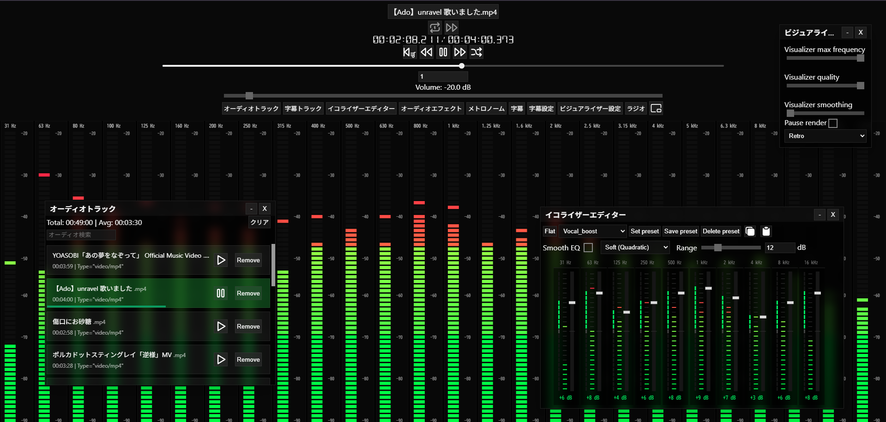
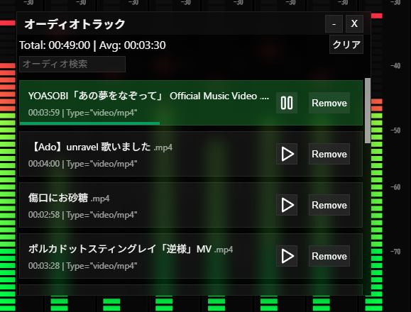
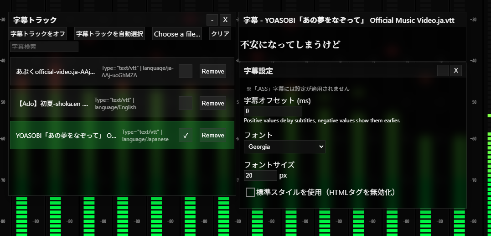
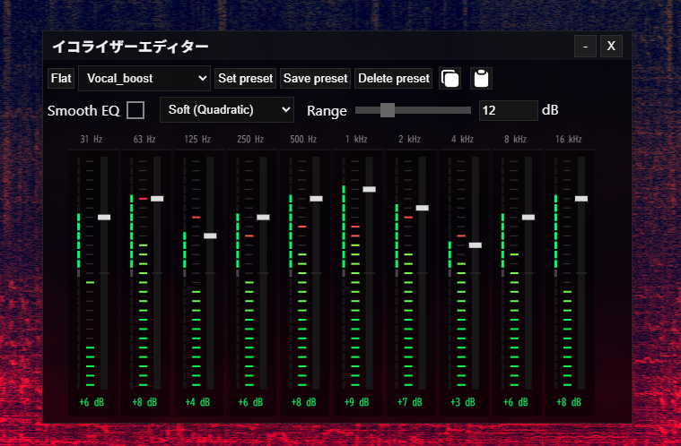
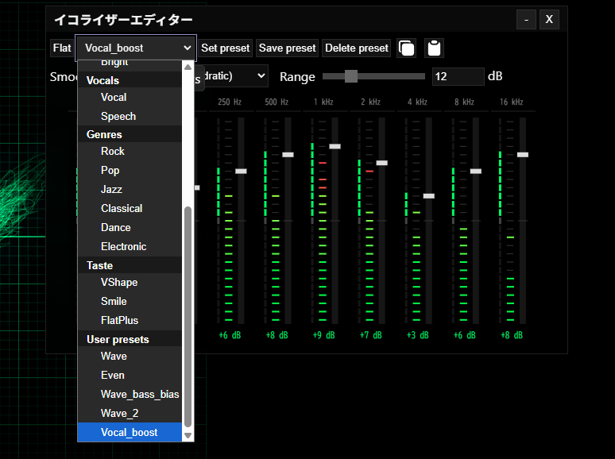
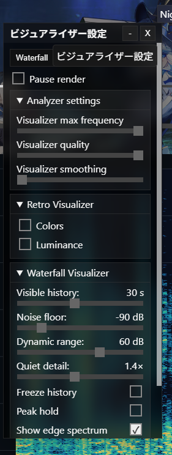
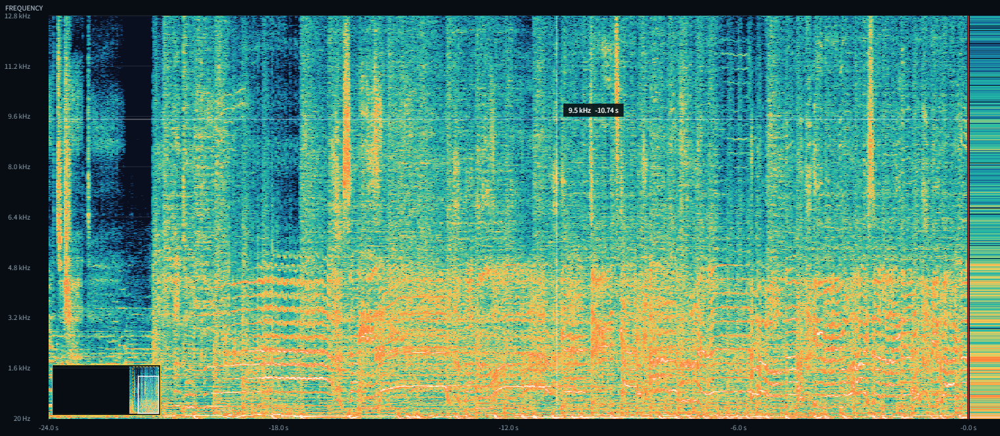
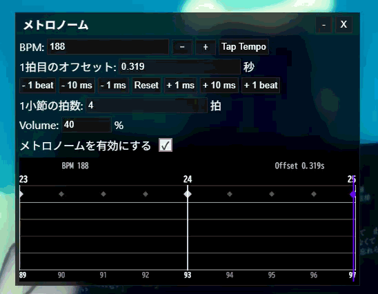
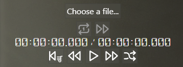

# Audio-Player-Visualizer

This is a personal project I made because I was bored.

It's a music player and visualizer that lets you to play audio files, manage playlists, use an equalizer, and, of course, enjoy various visualizations.

---

The project runs entirely locally, so there's no need for Docker. Most features work by opening the project in your browser; full ASS/SSA subtitle rendering requires opening it through a local web server because browsers restrict the workers used by the subtitle renderer on `file://` pages.

## The Player

### Fully Functional Playlist System

### Subtitle Support

Subtitle tracks support VTT and SRT, with ASS/SSA rendered by the bundled libass WebAssembly renderer. ASS/SSA rendering includes libass's positioning, collision handling, styling, animation, and karaoke support. Its browser worker and WebAssembly assets are vendored in `JS/vendor/libass-wasm/`

To use ASS/SSA subtitles, serve the project folder over localhost and open the local HTTP address in your browser. Direct `file://` opening remains available for other features, but without ASS/SSA support.

The player also supports automatic subtitle selection. This works when the audio file and subtitle file have very similar names.

### Equalizer

An equalizer editor is included for audio tuning.

Several built-in presets are available, and you can also create your own settings manually.

Custom presets can be saved and reused later.

Your saved presets can be found at the end of the preset dropdown.

### Analyzer and Visualizer Options

Here you can adjust settings such as the maximum frequency and other visualizer related options.

**Visualizer Quality** controls the analyzer's FFT size, which affects most visualization modes.

**Visualizer Smoothing** smooths out the analyzer data to reduce sharp changes.

**Pause Render** freezes the visualizer on its current frame without affecting audio playback.

### Waterfall

a render mode that shows with a waterfall style the frequency history and volume
You can pan with your mouse and zoom on the time axis
if you want to zoom on the frequency axis you can hold down <kbd>Shift</kbd> while scrolling.
There is also more options for this visualizer in the visualizer settings window.

### Metronome

There is also a simple metronome
with a built in "Tap tempo" so you can find the BPM of your song by just tapping.

you can also set an offset for the beats so you can line it up with the sound

### Playback Controls

Located at the top-center of the page, you'll find controls for:

* Loop Mode
* Play Mode
* Previous Track
* Next Track
* Play Random Track
* Play from the Beginning of the Playlist
* Play / Pause

### Loop Modes
---
The Loop button has two modes:

* Loop Once
* Loop

**Loop Once** plays the current audio track one additional time after it finishes.

**Loop** continuously repeats the current track.

### Play Modes
---
The Play Mode button has two modes:

* Auto Next
* Shuffle

**Auto Next** automatically plays the next track when the current one ends.

**Shuffle** randomly selects the next track when the current one ends.

### Combining Modes
---
The loop and play modes can also be combined.

 - **Loop Once + Auto Next**

Each track is played twice before automatically moving to the next track.

 - **Loop + Auto Next**

The entire playlist is played continuously. When the last track finishes, playback returns to the first track.

 - **Loop Once + Shuffle**

The current track is played twice, then a random track from the playlist is selected and played twice as well.

# License

The [MIT License](./LICENSE) applies to this project's original code.

# Third-party licenses

Third-party components and bundled assets keep their own licenses. See the
[jsmediatags BSD 3-Clause license](./licenses/jsmediatags.LICENSE.md),
[DSEG OFL-1.1 license](./licenses/DSEG-LICENSE.txt),
[Liberation Fonts OFL-1.1 license](./licenses/Liberation-Fonts-LICENSE.txt),
and the [JavascriptSubtitlesOctopus MIT license](./licenses/libass-wasm.txt).
The bundled subtitle renderer's other dependency notices and license texts are
listed in its [COPYRIGHT file](./JS/vendor/libass-wasm/COPYRIGHT).
